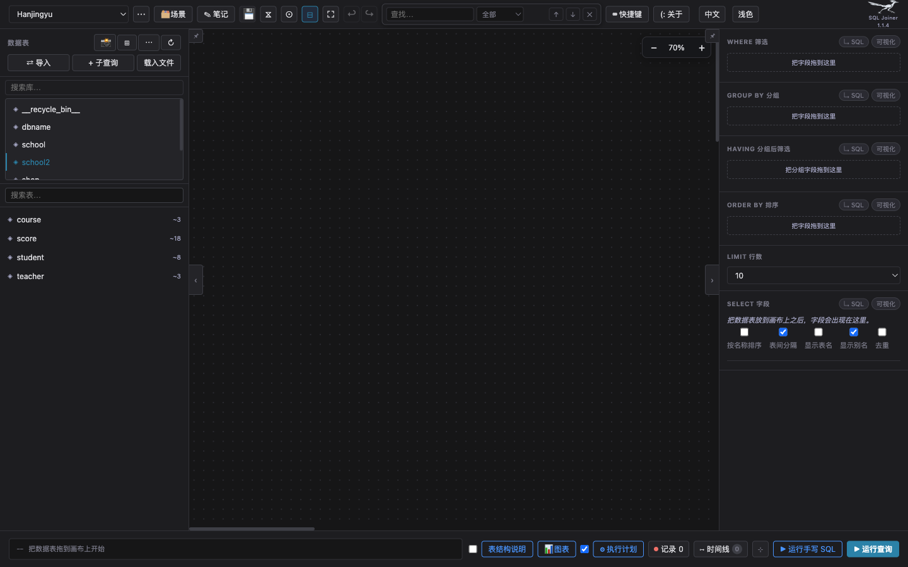
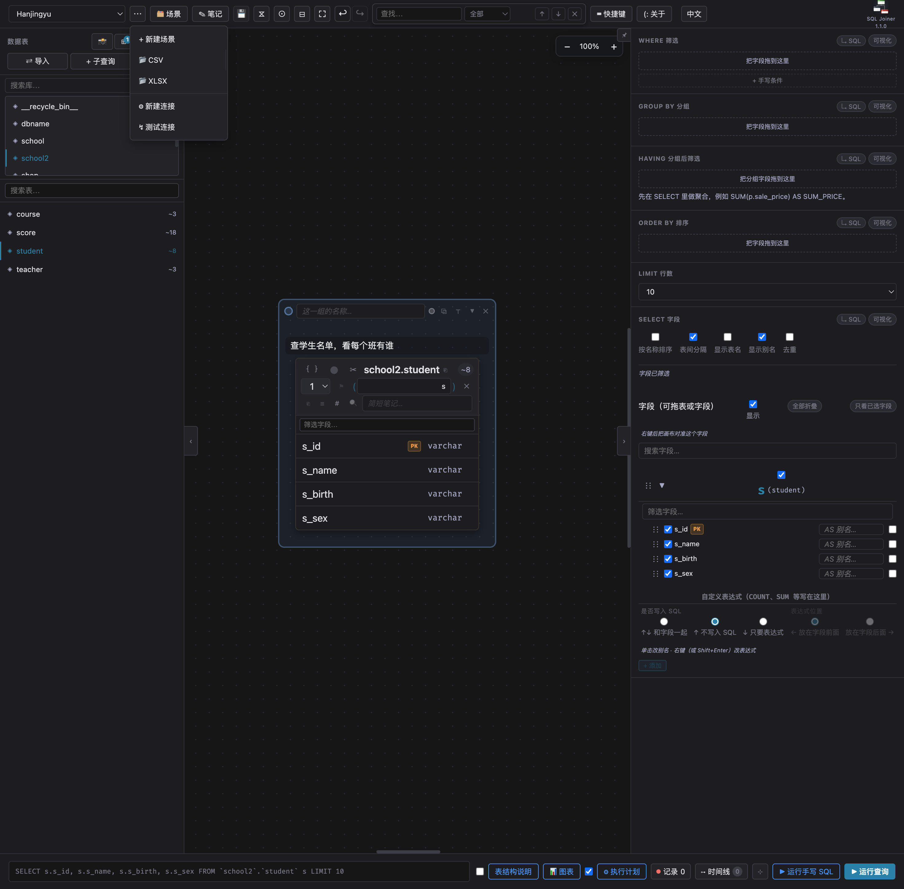
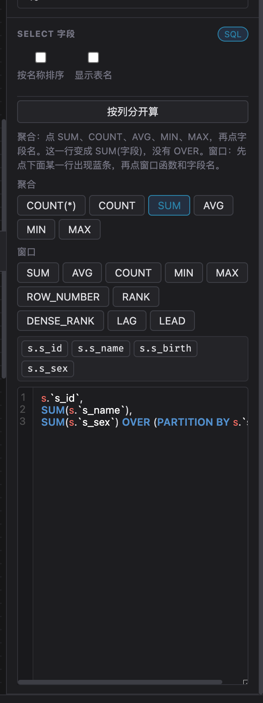

# SQL Joiner 使用说明

当前版本 **1.1.7**。窗口标题是 SQL Joiner。GitHub 仓库名是 JoannaSQLBuilderGUI，那是同一个软件。

这份说明只讲怎么用。开发、接口和打包见 `系统开发和使用需要知道的背景支持.md`。

## 这一版新加了什么

相对 1.1.6，1.1.7 多了这些：

- Mac 上能打开窗口。1.1.5 和 1.1.6 在画窗口之前就因为图标路径报错停住，屏幕上只剩菜单。
- 每次 Release 页面都写明：没有苹果签名时，怎么去掉隔离标记再打开。

相对 1.1.5，1.1.6 多了这些：

- LIMIT 行数增加**全量**和**分页**。全量不加 `LIMIT`。分页在结果栏翻页，并可以设置每页条数。换页会重新查询。
- Windows 安装程序在覆盖文件之前，会强制结束正在运行的 SQL Joiner，避免程序关不掉、语言数据包被占用。

相对 1.1.4，1.1.5 多了这些：

- 安装后的图标和窗口右上角换成走鹃剪影。
- 「按列分开算」分成两行。上面一行是普通聚合，写成 `SUM(字段)`，没有 `OVER`。下面一行才是窗口函数。
- 表名和字段名可以带空格或连字符，例如 `` `market data` ``、`` `winequality-red` ``、`` `fixed acidity` ``。拖到画布上时会自动加上反引号。

相对 1.1.3，1.1.4 多了三件事：

- 顶栏「中文」旁边可以切换**浅色**和**深色**。选择会记住。
- SELECT 切到 SQL 之后，字段按最外层的逗号分成一行一个。点「按列分开算」，可以给某一行套上窗口函数。
- 删掉一组表之后，`UNION ALL` 的连线和文字会一起消失。

1.1.3 已经可以在两张子查询卡片之间拉 `UNION` / `UNION ALL`。用法写在后面的「子查询和集合」一节。

## 1. 它做什么

把表拖到画布上，在字段之间拉线表示 JOIN，在右侧点选要查出的列和条件。底部会出现一条 SELECT。点「运行查询」，结果出现在下方。

它适合上课和探索：看这几张表为什么连在一起、条件写在 WHERE 还是 HAVING。画布上的一组表可以写一段说明，记下这次查询在查什么。

它不做账号和登录。连接和场景只存在这台电脑上。主路径是读查询。`DELETE`、`DROP` 以及分号后面的第二条语句不会执行。

## 2. 怎么打开

安装包在 [Releases](https://github.com/WangLaoShi/JoannaSQLBuilderGUI/releases/tag/v1.1.7)。安装包没有代码签名，也没有苹果公证。每次 Release 页面都有同样的打开步骤。

| 文件 | 给谁用 |
|---|---|
| `SQL.Joiner-1.1.7-arm64.dmg` | Apple 芯片的 Mac |
| `SQL.Joiner-1.1.7.dmg` | Intel Mac |
| `SQL.Joiner.Setup.1.1.7.exe` | Windows 安装程序 |
| `SQL.Joiner-1.1.7-win.zip` | Windows 解压后直接运行 |

从 GitHub 下载的 dmg 会被 macOS 标成隔离文件。第一次打开可能提示「已损坏，无法打开」或「无法验证开发者」。安装包没有坏，不要移到废纸篓。

1. 打开 dmg，把 SQL Joiner 拖到「应用程序」。已经装过的话，先用菜单栏退出旧的 SQL Joiner，再替换。
2. 打开「终端」，粘贴下面这一行后回车，去掉隔离标记：

```bash
xattr -dr com.apple.quarantine "/Applications/SQL Joiner.app"
```

3. 从「应用程序」或启动台打开 SQL Joiner。
4. 如果还是提示无法验证开发者：在 Finder 里按住 Control 点 SQL Joiner，选择「打开」，再点对话框里的「打开」。也可以到「系统设置 → 隐私与安全性」，点「仍要打开」。

Apple 芯片下载带 `-arm64` 的 dmg。Intel Mac 下载不带 `-arm64` 的那个。Windows 若出现 SmartScreen，选择「仍要运行」。

装好后的窗口自己带服务。它的连接和场景在系统用户目录里，和开发时的文件夹不是同一份。

从源码打开时，在 `node_app` 里执行 `npm install` 然后 `npm start`，浏览器打开 `http://127.0.0.1:4173`。地址只在本机。右上角的版本号是服务启动时读进去的，改了版本要重新启动才会变。

## 3. 窗口长什么样



从左到右、从上到下：

- **顶栏**：当前连接、⋯ 菜单、场景、笔记、保存、查找、快捷键、关于、语言、浅色或深色。右上角是图标和版本号。
- **左侧**：上面是库，下面是表。把表拖到中间的点阵上。
- **中间**：画布。表卡片、连线、每一组的标题和说明都在这里。
- **右侧**：WHERE、GROUP BY、HAVING、ORDER BY、LIMIT、SELECT。针对当前这一组。
- **底部**：生成的 SQL，以及「运行查询」「运行手写 SQL」「表结构说明」「图表」「执行计划」「记录」「时间线」。

一条可以保存的画布叫一个**场景**。互相连着的表组成一组。没有连线的一张表自己就是一组。右侧和「运行查询」针对当前选中的那一组。画布上有多组又没选中任何一组时，底部会提示先选一组。

## 4. 连接数据库

左上角先选择连接。没有连接时，点 ⋯。



「新建连接」里选 MySQL 或 SQLite。

- **MySQL**：名称、主机、端口、数据库、用户名、密码。左侧上面那一栏是库的列表。
- **SQLite**：一个本机文件路径。

密码写在这台电脑上，软件不加密。不要把这台服务放到公网上给别人访问。

「测试连接」用来确认当前选中的连接打得开。点左侧的库名，下面列出表。表名旁的 `~8` 这一类数字来自 MySQL 的估算行数，不是 `SELECT COUNT(*)`。和实际查出来的行数对不上是正常的。SQLite 没有这个估算，行数位置写 0，前面不加 `~`。

## 5. 把表放到画布上

从左侧把表拖到点阵上。同一张表可以放多次，每次有自己的别名，用来做自连接。

卡片上能看到字段。主键会标出来。卡片可以拖动位置。点卡片上的 ✕ 把它从画布拿掉。拿掉之后，连到它的 JOIN 和 `UNION` 线一起消失。

每一组标题下面可以写说明，占位文字是「这一组要查什么、为什么…」。点进去之后可以加粗、斜体、列表。字变多时，说明区域向上长，里面的表不动。说明跟场景一起保存。

## 6. 表和表怎么连

从一个字段拖到另一张表的字段上，拉出一条 JOIN。线上的文字是连接类型，点它可以改：

INNER JOIN、LEFT JOIN、RIGHT JOIN、FULL OUTER JOIN、CROSS JOIN。

一条线是 `别名A.列 = 别名B.列`。同一对表可以再加几对字段，它们用 AND 接在同一个 ON 里。

线上不能写「列 = 一个常数」。常数条件放到右侧 WHERE。关掉一条连线之后，如果两张表不再相连，它们就分成两组。

## 7. 右侧：选出什么、怎么过滤

每一段标题右边有「SQL」和「可视化」。可视化是点选。SQL 是直接写这一段的文本。

### SELECT 字段

- 勾选要出现的列。新拖上的表默认全选。
- 每列可以写 `AS 别名`。
- 「按名称排序」只改生成的 SQL 里列的顺序，不改右侧清单的顺序。
- 「表间分隔」在不同表的列之间放入分隔标记。
- 「显示别名」「显示表名」影响结果表头怎么写。
- 「去重」生成 `SELECT DISTINCT`。
- 底部可以添加自定义表达式，例如 `SUM(p.sale_price)`，别名写成 `SUM_PRICE` 这种不含空格的名字。
- 纳入方式三选一：「和字段一起」「不写入 SQL」「只要表达式」。
- 求和、计数要写成表达式。原字段 `p.sale_price` 不是 `SUM(p.sale_price)`。

### WHERE

分组之前过滤行。运算符包括等于、不等于、大小比较、LIKE、NOT LIKE、IS NULL、IS NOT NULL、IN、NOT IN、BETWEEN、NOT BETWEEN。

值原样进入 SQL。字符串要自己加引号：`'衣服'`、`'猴%'`。数字可以不写引号。`IN` 的值写成 `(1, 2, 3)` 这种你希望出现在 SQL 里的样子。

也可以点「用 JSON 生成 WHERE」：粘贴一个 JSON 对象，每个键值变成一条「字段 = 值」。

### GROUP BY

把行收成组。可视化是把 `别名.列` 拖进来，例如 `p.product_type`。

### HAVING

分组之后过滤组。先在 SELECT 里做好聚合并起别名，然后在 HAVING 里点那个别名，填写 `> 600`。生成的是 `HAVING SUM_PRICE > 600`。

已经放进 GROUP BY 的列可以拖进 HAVING。没有分组的原始列，例如单独的 `sale_price > 600`，要放在 WHERE。

### ORDER BY

可视化只接受 `别名.列` 加升序或降序。要对聚合结果排序，把这一段切到 SQL，写 `SUM_PRICE DESC`。

### LIMIT

可选 1、10、100、500、1000。默认 10。服务端最多 5000。每条由画布生成的查询都会带 LIMIT。想看更多行，把这个数调大。

## 8. 窗口函数

这是 1.1.4 新加的。在右侧 SELECT 标题上点「SQL」。



字段会按最外层的逗号分成一行一个。函数括号里的逗号不会被拆开。框是空的时候，点「按列分开算」会按画布上的表，把字段写成一行一个。还没有表时，框里会提示先把表放到画布上。

按钮分成两行，不要混用：

- **聚合**：点 SUM、COUNT、AVG、MIN、MAX，再点字段名。选中的那一行变成 `SUM(字段)`，没有 `OVER`。`COUNT(*)` 不用点字段，直接加进去。
- **窗口**：先点下面某一行，整行出现蓝条。再点 SUM、AVG、COUNT、MIN、MAX、ROW_NUMBER、RANK、DENSE_RANK、LAG、LEAD 里的一个，然后点字段名。这一行写成 `SUM(字段) OVER (PARTITION BY 字段)`。ROW_NUMBER、RANK、DENSE_RANK 写成 `ROW_NUMBER() OVER (PARTITION BY 字段)`。

打开时选中的是聚合里的 SUM。要点窗口，先点窗口那一行里的函数。

函数写进去的时刻是点字段名的时候。这里没有 `ORDER BY`，也没有帧子句。`NTILE`、`FIRST_VALUE`、`LAST_VALUE` 不在按钮里。需要那些写法时，直接改这一行的 SQL。

## 9. 子查询和集合

左侧「+ 子查询」在画布上放一张卡片。在卡片里写一条 SELECT。

两张子查询可以从标题上的 ∪ 拖到另一张上，连成 `UNION ALL`。点连线中间的文字改成 `UNION`，点 × 去掉。每张卡片只能连出一条、连入一条，所以多张卡片排成一条链。

合并之后：

- 外层别名固定是 `u`。
- 右侧的 WHERE、GROUP BY、ORDER BY、LIMIT 作用在合并之后的结果上。
- 没有单独勾选字段时，SELECT 是 `u.*`。
- 这一组里不要再拉 JOIN。普通表卡片不能用 ∪。
- 各张卡片列出的列数要一样。

卡片上单独运行时，结尾分号可以留着。底部「运行查询」把它放进 `FROM ( ... )` 时会去掉这个分号。

查出的列要自己登记。在卡片的「添加连接字段」里输入列名或别名，必须和 SELECT 里的列名或别名一致。登记之后，这些列出现在右侧，也可以拖去和别的表连线。没有和任何表连线的子查询，自己是一组。

`INTERSECT` 和 `EXCEPT` 没有按钮。写在某张卡片的 SQL 里时，会随那张卡片一起交给数据库。

「载入文件」读 `.sql` 或 `.csv`。`.sql` 把文件内容放进卡片。`.csv` 把每一行变成一条 SELECT，再用 `UNION ALL` 接起来。第一行当表头，变成别名。数字不加引号，空单元格变成 `NULL`，字符串加单引号。

菜单里的 CSV / XLSX 是给结果比较用的，不会在数据库里建一张真实的表。

「导入」把一条已有 SQL 拆回画布。复杂 SQL 可能只导入一部分。导入前会询问是追加，还是清空再导入。

## 10. 运行和看结果

底部条上是当前组生成的 SQL。点「运行查询」，或按 Cmd/Ctrl + Enter。结果表出现在下方，可以复制单元格、调整列宽、排序、搜索。

正在跑的查询可以停止。停止对 MySQL 发 `KILL QUERY`。已经返回的结果还在。

「运行手写 SQL」打开一个文本框，执行你贴进去的语句，不经过画布拼接。它不会把那条 SQL 变成画布上的表，除非你再用「导入」。

「表结构说明」生成用到的表的 SELECT 和 CREATE TABLE，可以复制或存成文件。

「执行计划」对当前查询做 EXPLAIN。手写 SQL 窗口开着时，也有单独的执行计划按钮。

## 11. 图表、比较、记录、时间线

查询有结果之后，从底部按钮打开：

- **图表**：文字列当分类，数字列当数值。可以画线图、柱图、排行榜、条形图、箱型图、直方图、饼图、雷达图、气泡图、漏斗图。选一种后「加入画板」，再换一种继续加入。箱型图和直方图看分布。雷达图至少 3 个分类。饼图和漏斗图使用大于 0 的数。气泡图有两列数字时分别是横轴和纵轴，第三列数字决定气泡大小。图可以钉住，钉住的图可以翻页。
- **比较 CSV**：按行、按格子和另一份 CSV 对，不一样的格子会标出来。两边的行数和列数要一样。
- **比较列**：打算用选中的列和下一次查询或一份 CSV 做差集、交集、并集。这个窗口在结果区里。当前版本里，算出结果的那一步还没有接上，点运行不会得到一张新表。
- **记录**：把一次查询的 SQL 和结果记下来，可以分组、替换、搜索。
- **时间线**：给结果里的记录选一个日期字段，排到时间轴上。可以多轨、导出。时间线上的放大缩小是时间线自己的，不是画布右上角那一组。

## 12. 场景、笔记、撤销

顶栏「场景」打开列表：可以重命名、复制、保存到本机文件。场景包括表、连线、右侧条件、组标题、组说明、颜色。

顶栏软盘：这份画布是从某个场景打开的，就覆盖保存；否则另存为。

顶栏「笔记」是整份场景的长笔记，和画布上每一组的说明分开。保存按钮在右下角。

撤销和重做在顶栏。大约保留 30 步，只在当前这个标签的内存里。刷新或关掉标签之后就没了。要留下查询，用场景保存。

在输入框、文本区、组说明里打字时，Ctrl 或 Cmd + Z 先给这个输入框自己用。

## 13. 浅色和深色

顶栏「中文」旁边的按钮，在深色时写着「浅色」，在浅色时写着「深色」。点一下就换，选择记在这台电脑上，下次打开还是这个。SQL 编辑框的底色跟着主题走。

语言按钮在它左边，在中文和 English 之间切换。SQL 关键字、表名、字段名和结果单元格保持原文。

## 14. 画布怎么移动和缩放

- 在空白处按住左键或右键拖动：平移。
- 滚轮：滚动，不缩放。
- 按住中键上下拖：围绕按下的位置放大或缩小。向上放大，向下缩小。
- 按住 Ctrl（Mac 上也可按住 Cmd）再滚动滚轮：围绕光标缩放。
- 画布右上角 − / 百分比 / +：每次大约 12%。
- 范围大约 50% 到 200%。打开时先停在 70% 总览。
- 顶栏总览按钮：在 100% 和 70% 之间跳。

侧栏、顶栏、右侧、结果表的字号不变。若整个窗口的字都变大了，那是操作系统或安装包窗口的缩放，不是这个按钮。

小地图用来在大画布上找到表。查找框可以按表、别名、连线标签、组标题、结果列来找，并滚到对应位置。

## 15. 多标签

从 `http://127.0.0.1:4173/` 进入时，最上面有一行标签。点 `+` 新建。每个标签是一份独立画布。

标签不会自动保存场景。关掉标签前，需要留下的查询要先存成场景。关掉的标签可以重新打开最近约 10 个。

## 16. 常用快捷键

顶栏「快捷键」打开完整列表，并随中英文切换。Mac 上的 Cmd 对应 Windows 上的 Ctrl。

| 按键 | 作用 |
|---|---|
| Cmd/Ctrl + Enter | 运行查询 |
| Cmd/Ctrl + E | 当前查询的执行计划 |
| Cmd/Ctrl + P | 把当前结果画成图 |
| Cmd/Ctrl + K | 表结构说明 |
| F4 | 总览缩放（100% 与 70%） |
| F5 | 专注模式：隐藏面板，再按一次恢复 |
| F9 | 显示或隐藏右侧面板 |
| Cmd/Ctrl + F9 | 打开手写 SQL；已经打开时运行它 |
| F11，或 Cmd/Ctrl + Alt + F | 全屏 |
| Alt + 1 / 2 / 3 | 左表列表 / 右侧面板 / 结果面板 |
| Alt + N | 笔记 |
| Alt + O | 场景列表 |
| Alt + S | 添加子查询 |
| Alt + I | 导入 SQL |
| Ctrl + Alt + T | 新标签 |
| Ctrl + Alt + W | 关闭标签 |

在子查询编辑窗口里，Alt 的含义会变成编辑命令。以那个窗口自己列出的说明为准。

## 17. 画布做不到的，以及容易误以为是故障的

做不到、或做出来和手写不一样的：

- JOIN 的 ON 不能写「列 = 常数」或函数。放到 WHERE，或写进子查询、手写 SQL。
- ORDER BY 的点选不能直接选聚合别名。切到 SQL 再写。
- `UNION` 那一组不能再拉 JOIN。普通表不能用 ∪。
- 窗口函数只有「函数 + PARTITION BY 一个字段」这一种按钮。CTE（`WITH`）、`EXISTS`、相关子查询仍然要自己写 SQL。
- 把整份 SQL 粘进「运行手写 SQL」，不算画布已经把它搭出来了。

使用时这些情况不是故障：

- 左侧 `~` 行数和结果行数不同：那是估算。
- 字符串条件没有引号就报未知列：给值加上引号。
- `Duplicate column name`：两个 SELECT 选出了同一个列名。给其中一个起别名。
- 刷新没变化：用强制重新加载。已经开着的窗口经常会拦住普通刷新。
- 整页字变大、侧栏也变大：那是系统或窗口缩放。画布自己的缩放只影响中间点阵。
- 右上角仍是旧版本号：重新启动软件或本机服务。
